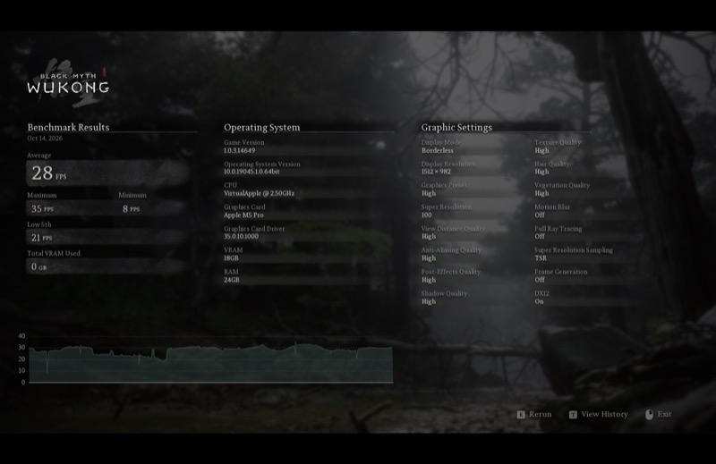

# Mullion

Mullion translates Direct3D 10, 11 and 12 to Metal, so Windows games run on Apple silicon through Wine. It is free and open source, and it is a pre-release: expect games that break, and please report them.

## Status

| | Mullion | D3DMetal |
|---|---|---|
| Black Myth: Wukong benchmark, High preset, 1512 × 982, TSR at 100%, no frame generation | 28 FPS | 35 FPS |
| 3DMark Fire Strike | 7003 | |

Both columns are from the same M5 Pro. Time Spy's graphics tests render correctly but 3DMark does not show a score for them yet, and Steel Nomad does not start yet.

| Mullion | D3DMetal |
|---|---|
|  |  |

What is implemented:

- Direct3D 12 at feature level 12_0 with shader models up to 6.6: ray tracing at tier 1.1, mesh and amplification shaders, tessellation, geometry shaders, stream output, sampler feedback, reserved resources, pipeline libraries and planar video formats.
- Direct3D 10 and 11 at feature level 11_1.
- 192 test programs that draw, read the result back and compare it with what the Direct3D specification says, run as each Apple GPU family. Wine's and vkd3d-proton's Direct3D tests are run against it as well, and their verdicts are recorded in `tests/conformance`.

## Requirements

- A Mac with an M3 or later. M1 and M2 are in progress.
- macOS 15 or later.
- A Wine for x86_64. Stock Wine works: Mullion needs no patches and no DLL overrides. Only 64-bit games run for now.

## Install

1. Download the latest [release](https://github.com/dttdrv/mullion/releases) and unpack it.
2. Run `./install.sh <wine> [prefix ...]`, where `<wine>` is the directory that contains `bin/wine`.

The script copies the libraries into `<wine>/lib/wine`, where they take the place of Wine's Direct3D, and into each prefix you name. Prefixes created afterwards need nothing.

The archive has the layout of DXMT's builds (`x86_64-windows` and `x86_64-unix`), so a tool that installs DXMT can install Mullion the same way. By hand: copy both directories into `<wine>/lib/wine`, and the DLLs of `x86_64-windows` into `drive_c/windows/system32` of each existing prefix.

## Configuration

| | |
|---|---|
| `MULLION_LOG_PATH=<directory>` | Writes a log file for each DLL. Attach it to bug reports. |
| `MULLION_CONFIG="dxgi.customVendorId=106b"` | Reports Apple's vendor ID. By default Mullion reports the GPU's own name with AMD's vendor ID, because some games exit at startup when they do not know the vendor. |

Options can also go in a `mullion.conf` next to the game's executable, or in the file `MULLION_CONFIG_FILE` names; the `mullion.conf` in this repository lists them. The `DXMT_` names and `dxmt.conf` of earlier builds still work.

## Building

You need macOS, Meson 1.3 or later, Xcode with its Metal toolchain, LLVM 15 as static libraries for x86_64, [llvm-mingw](https://github.com/mstorsjo/llvm-mingw) and a Wine build tree.

```sh
git submodule update --init
meson setup build --cross-file build-win64.txt \
  -Dnative_llvm_path=<llvm> -Dwine_build_path=<wine build tree> \
  --buildtype release --prefix "$PWD/install"
meson install -C build
```

`install/` then has the layout of a release. With `-Dwine_builtin_dll=false` the DLLs are built for a prefix's `system32` instead, and need `WINEDLLOVERRIDES="d3d12,d3d12core,d3d11,d3d10core,dxgi=n"`.

## Tests

Configure with `-Denable_tests=true`, then run the suite in a Wine, once as each GPU family:

```sh
python3 tests/run.py --build build --wine <wine> --prefix <prefix> --family native,9
```

The tests compile their own shaders, so the prefix needs `d3dcompiler_47.dll` (from [winetricks](https://github.com/Winetricks/winetricks)) and `dxcompiler.dll` (from [DirectXShaderCompiler](https://github.com/microsoft/DirectXShaderCompiler)) in its `system32`.

## Reporting

Open an issue for a game that breaks, with your Mac model, macOS version, how you ran the game, and the log. A screenshot helps most. Reports of games that work are just as welcome. See `CONTRIBUTING.md` for patches.

## Credits

Mullion is built on [DXMT](https://github.com/3Shain/dxmt) by Feifan He and CodeWeavers, from commit `7c8dee1` (16 September 2026). DXMT is the Direct3D 10 and 11 foundation, the DXBC shader converter and the Metal bridge. The DXIL front end and most of the Direct3D 12 are ours: about 28,000 lines of source and 75,000 lines of tests so far.

Mullion is a separate project. Please do not report its problems to DXMT.

Thanks to [DXVK](https://github.com/doitsujin/dxvk), whose utility code DXMT carries; to [Wine](https://www.winehq.org) and [LLVM](https://llvm.org); to Microsoft for the [DirectX specifications](https://microsoft.github.io/DirectX-Specs/) and [DirectXShaderCompiler](https://github.com/microsoft/DirectXShaderCompiler); to Apple for the [Metal documentation](https://developer.apple.com/documentation/metal); and to [vkd3d-proton](https://github.com/HansKristian-Work/vkd3d-proton) and [Mesa](https://www.mesa3d.org), whose tests and drivers we learned from.

## License

LGPL, version 2.1 or later, like DXMT. See `LICENSE`. `LICENSE.OLD` is the license DXMT had before April 2026, which still covers the code from then.
